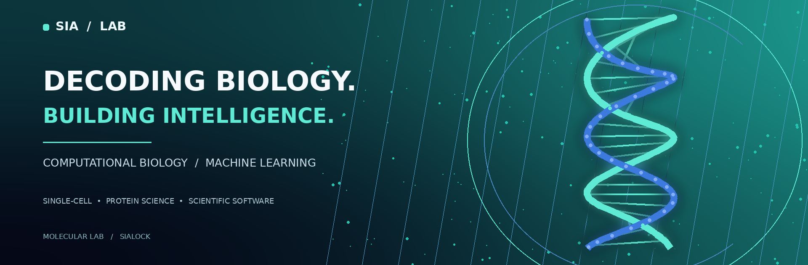
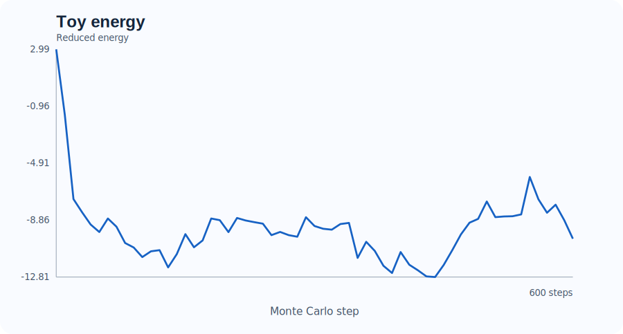
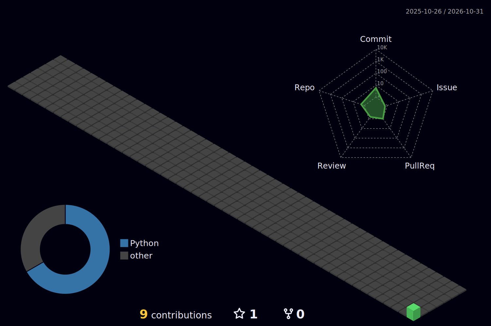

  

**Computational Biology · Machine Learning · Reproducible Research**

I develop testable tools for single-cell genomics, protein structure analysis, and biological data science.

[Explore the work](#featured-research-software) &nbsp;·&nbsp; [3D activity](#3d-contribution-landscape) &nbsp;·&nbsp; [Research interests](#research-focus)

---

## Featured research software

<table>
<tr>
<td width="50%" valign="top">

<h3 align="center">🧬 <a href="https://github.com/sialock/DonorShift-Bench">DonorShift-Bench</a></h3>

<b>Single-cell ML on unseen patients</b>

Reproducible donor-held-out cell-type benchmarking, training-only gene selection, per-donor metrics, and offline reports.

Python · scRNA-seq · scikit-learn · PyTorch

<a href="https://github.com/sialock/DonorShift-Bench"><b>Source code & documentation →</b></a>

</td>
<td width="50%" valign="top">

<h3 align="center">🧪 <a href="https://github.com/sialock/protein-folding-">Protein-MC-Go</a></h3>

<b>Reproducible Monte Carlo structural experiments</b>

Seed-controlled native-biased Cα simulations, structural diagnostics, command-line tools, and automated tests.

Python · Biopython · Monte Carlo · CI

<a href="https://github.com/sialock/protein-folding-"><b>Source code & documentation →</b></a>

</td>
</tr>
</table>

Both example plots are based on synthetic demonstrations. DonorShift-Bench does not claim clinical validation; Protein-MC-Go is not a de novo protein-folding predictor.

## 3D contribution landscape

  

This visualization is generated from GitHub contribution data and refreshed weekly by [GitHub Actions](./.github/workflows/profile-3d.yml). It is rendered to PNG rather than embedded as an animated SVG.

## Research focus

| Area | Questions and methods |
|:---|:---|
| **Single-cell genomics** | Cell identities, inter-patient generalization, and robust evaluation |
| **Protein intelligence** | Structure representations, protein language models, and interpretable analysis |
| **Metagenomic discovery** | Enzyme-candidate triage and evidence-aware annotation |
| **Scientific software** | Reproducibility, data integrity, automation, and transparent limitations |

### Tools I work with

`Python` · `PyTorch` · `scikit-learn` · `Scanpy` · `AnnData` · `Biopython` · `NumPy` · `GitHub Actions`

---

**Biological questions first. Reliable software and clear evidence always.**

[All repositories](https://github.com/sialock?tab=repositories) · [Three visual themes](./docs/design-options.md)

SIA / LAB is a visual identity for this personal research-software portfolio. The hero artwork is illustrative, not an experimental molecular structure.

